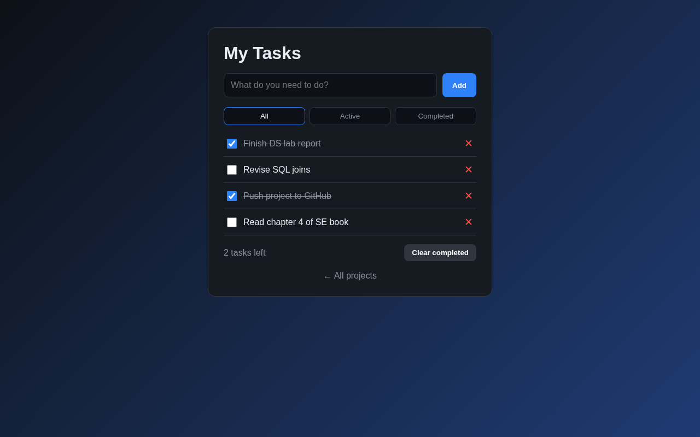

# Web Development Projects


Four small, responsive front-end projects from my Web Development course, built with **plain HTML, CSS and JavaScript** (no frameworks).

**Live demo:** https://dhiaalhaq7979.github.io/Web-Development/

| Project | Live demo | What it shows |
|---|---|---|
| Landing page | [open](https://dhiaalhaq7979.github.io/Web-Development/landing-page/) | Semantic HTML, Flexbox + Grid, media queries, mobile hamburger menu |
| Form validation | [open](https://dhiaalhaq7979.github.io/Web-Development/form-validation/) | Live validation with regex, password-strength bar, error states |
| To-do app | [open](https://dhiaalhaq7979.github.io/Web-Development/todo-app/) | DOM manipulation, filters, `localStorage` persistence |
| Calculator | [open](https://dhiaalhaq7979.github.io/Web-Development/calculator/) | Keyboard support, operator precedence **without `eval()`** (shunting-yard) |

## Screenshots

**Landing page (desktop and mobile)**


**Form validation**


**To-do app**



**Calculator**


## Run locally

No build step is needed — open `index.html` in a browser, or serve the folder:

```bash
python -m http.server 8000   # any static server works
# then open http://localhost:8000
```

## Tested behaviour

- Form: short name, bad email, weak password and mismatched confirmation each show their own error; valid data shows the success message.
- To-do: tasks survive a page reload; the counter and the *Active / Completed* filters update correctly.
- Calculator: `2+3×4 = 14`, `10÷4 = 2.5`, `-5+2 = -3`, `50% = 0.5`, `0.1+0.2 = 0.3`, and `7÷0` shows *Cannot divide by 0*.

## Author

**Dheya Alhag** — BS Software Engineering, Superior University, Lahore
GitHub: [@dhiaalhaq7979](https://github.com/dhiaalhaq7979)
